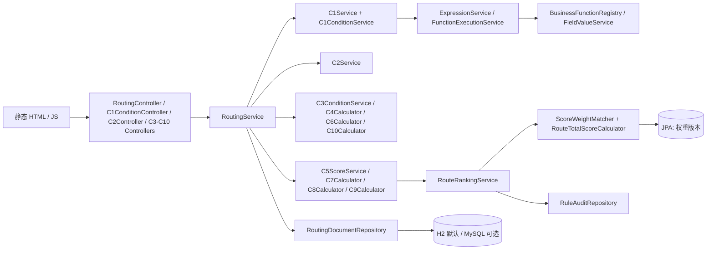

# HSG RELAY 技术架构与实现说明

审查范围：`hsg-relay-demo` 当前源码；2026-11-26。结论来自源码和测试文件的静态审查，未把其他同名工程、README 描述或页面标题当成实现证据。本文中的路径均相对工程根目录。

## 技术栈与结构

`pom.xml` 定义 Java 17、Spring Boot 3.3.5、Web、Spring Data JPA、H2、MySQL 驱动及 Aviator 5.4.1；未见 URule 依赖或集成。`application.yml` 默认 H2 文件库 `./data/relaydb`、JPA `ddl-auto:update`、8080 端口；`application-mysql.yml` 提供 MySQL profile。前端为 `src/main/resources/static/*.html`、原生 JS/CSS，无前端构建框架。启动可用 `mvn spring-boot:run`，本地页面 `/`、`/fields.html`、`/provider-detail.html`、`/c5.html`、`/routing.html`。`DemoData`、`C2DemoData`、`CollectionMetadataSeed`、`C5ScoreMetadataSeed`、`RoutingScoreWeightSeed` 在启动时提供演示/默认数据，实际库中运营改动应以 GET 查询为准。



## 主流程与数据

`RoutingController.simulate` → `RoutingService.simulate/evaluate`：读取 `RoutingDocument` 的 `CONFIG` JSON，缺失时读取 `routing-demo.json`；按 LIVE 合作方和 `NONE/TREASURY/PROVIDER` FX Venue 生成候选；逐个执行 C1、C2、C3、C4、C6、C10，记录所有检查原因；C3 命中行传给 C5 计算起息日及已发布评分；通过过滤者计算 C7/C8/C9；`RouteRankingService.rank` 使用单套生效权重，返回主路由和最多两个备选。`RoutingService.simulate` 把请求和响应写入 `DECISION-<UUID>`，`decision` 可回查；结果标记 `simulation=true`、`opsCheckRequired=true`，不占用真实资金或额度。证据：`RoutingService.java:243-252,277-378`、`RoutingController.java:9-33`、`RoutingDocument.java`。

| 数据类别 | 当前落点 | 性质与边界 |
|---|---|---|
| 合作方/客户/准入/排除/审批/MTD | `Provider`、`ClientProfile`、`Appetite`、`ClientExclusion`、`CaseApproval`、`ProviderUsage` JPA 实体 | 本地演示档案与配置；并非实时 KYC、支付账务 |
| 覆盖行、余额/占用、手续费、日累计、协议/月进度、FX 窗口 | `RoutingConfig` → `RoutingDocument(CONFIG)` JSON；默认 `routing-demo.json` | 可修改持久化，但不是独立实时账务表；`RoutingService.config/saveConfig` |
| 字段/函数、条件 | `FieldDefinition`、`BusinessFunctionDefinition`、`C1ConditionConfig`、C2/C3 条件实体 | 元数据与条件 JSON；函数元数据不等于可执行 Handler |
| C5 评分、权重 | `ScoreRuleConfig/ScoreRuleVersion`、`RoutingScoreWeight` | 草稿/已发布版本；`ScoreRuleService`、`RoutingScoreWeightService` |
| 决策/操作审计 | `RoutingDocument(DECISION-*)`、`RuleAudit` | 模拟结果与部分配置、排序审计；非不可篡改金融审计 |

MySQL 初始脚本 `sql/schema-mysql.sql` 覆盖基础表和路由文档；新评分与权重实体依赖 JPA 映射，应在部署前核对正式 DDL/迁移。`application.yml` 的 `ddl-auto:update` 不能作为生产迁移方案。

## C1–C10 执行核对

| 规则 | 数据与逻辑 | 配置/试算/主流程 | 证据与边界 |
|---|---|---|---|
| C1 | 客户档案、全局准入树、逐类别 Appetite、审批、MTD；树不满足即 `C1_CONDITION_NOT_MATCHED`；排除记录仅在条件显式引用时参与 | `/`、合作方详情；`/api/c1/simulate`；已接入 | `C1Service.evaluate`、`C1ConditionService.evaluate`、`C1ServiceTest`；当前客户排除**不是硬性必检**，需核对业务政策 |
| C2 | 合作方限制、监管规则、能力标签，汇总命中原因 | `/c2.html`、合作方详情、监管规则页；`/api/c2/simulate`；已接入 | `C2Service.simulate`、`C2ServiceTest`；国籍等来自演示请求，不是权威客户源 |
| C3 | 覆盖行币种/国家/地区/BIC/扣费，选择最精确行，亦可配置全局条件 | `/c3.html`、合作方详情；`/api/c3/simulate`；已接入 | `C3Matcher`、`C3ConditionService`、`C3ServiceTest`；覆盖行仍在 CONFIG JSON |
| C4 | 余额减占用与支付需求比较，可按合作方开关 | `/c4.html`、合作方详情；`/api/c4/simulate`；已接入 | `C4Calculator`、`C4ServiceTest`；余额是配置快照，无真实资金预占 |
| C5 | C3 覆盖行截单、时区、节假日、偏移算候选起息日；已发布 FIRST_MATCH 评分版本给 0–100 分 | `/c5.html`、合作方详情；`/api/c5/simulate` 与 `/api/c5/score-rule`；已接入 | `C5Calculator`、`C5ScoreService`、`ScoreRuleEngine`、`C5ScoreServiceTest`；不能假定分数恒为 100/50/0，须看生效版本 |
| C6 | 覆盖行单笔/每日 USD 限额加当日累计 | `/c6.html`、合作方详情；`/api/c6/simulate`；已接入 | `C6Calculator`、`C6ServiceTest`；累计为 CONFIG 演示数，无并发预占 |
| C7 | 手续费、固定/比例/上下限、FX spread 估成本，再按合格候选最低成本换算分数 | `/c7.html`、合作方详情；`/api/c7/simulate`；已接入 | `C7Calculator`、`C7ServiceTest`；汇率/费率不是实时报价 |
| C8 | 按合作方、币种、国家、地区、金额、交易类型和层级匹配偏好 | `/c8.html`、合作方详情；`/api/c8/simulate`；已接入 | `C8Calculator`、`C8ServiceTest`；配置在 CONFIG JSON |
| C9 | 商业协议月目标与 MTD 进度评分 | `/c9.html`、合作方详情；`/api/c9/simulate`；已接入 | `C9Calculator`、`C9ServiceTest`；月度进度为演示配置 |
| C10 | FX Venue、日期时间、窗口和额度判断；可提示下个窗口 | `/c10.html`；`/api/c10/simulate`；已接入 | `C10Calculator`、`C10ServiceTest`；未对接真实 FX 执行 |

这些是“代码实现且存在测试文件”的结论；本轮未重跑全量测试或验证当前 H2 内容，故当前运行环境结果仍需现场确认。

## 动态规则与集合调用链

`FieldMetadataController` 保存字段编码、类型、运算符、适用规则、取值来源；`BusinessFunctionController/FunctionMetadataService` 保存函数说明与 Handler 绑定，`BusinessFunctionRegistry` 只暴露已注册 Java 实现。`ExpressionService.Node` 支持 FIELD、FUNCTION、GROUP（嵌套 AND/OR，深度和项数限制），`compileDetailed` 校验并生成受控 Aviator 表达式，`evaluate` 调用字段解析和函数，再执行 Aviator。JSON AST 由 C1 全局条件与部分规则配置存储；规则版本、错误处理因规则类型而异。证据：`ExpressionService.java:55-216,237-306`、`FunctionExecutionService.java:68-175`、`RuleExecutionContext.java:48-197`。

集合案例的实际链路：`CollectionMetadataSeed` 注册 `providerExcludedClientIds`（STRING_SET，DATA_RESOLVER）和 `collectionContains`；前端 `fields.html/functions.js/c1-conditions.js` 可选字段、函数和参数；条件 JSON 的 FUNCTION 节点引用 `collectionContains`，`arguments.collection` 绑定元数据字段，`arguments.element` 绑定 `transaction.clientId`。`FunctionArgumentResolver` 解析绑定，`FieldValueService` 经 `ProviderExclusionListResolver` 调用 `ClientExclusionChecker.exclusionSet`，从 `relay_client_exclusion` 读取该候选合作方在决策时间有效的排除记录；`CollectionContainsFunction.execute` 做成员查询，BOOLEAN 结果由 `ExpressionService.evaluate` 代入比较。若配置 `== false`，非排除客户满足条件，排除客户不满足时 C1 返回 `C1_CONDITION_NOT_MATCHED`。这是**可配置的链路**，当前数据库是否保存了这一具体条件须以 GET `/api/c1/condition` 核对。证据：`CollectionMetadataSeed.java:19-76`、`ProviderExclusionListResolver.java`、`ClientExclusionChecker.java:47-172`、`FunctionArgumentResolver.java:56-168`、`CollectionContainsFunction.java:38-49`、`C1Service.java:121-145`；集合测试 `CollectionFunctionTest`、`CollectionMembershipQueryTest`。

适合演示的条件节点形态如下，属于**建议配置样例，并非声称当前库已保存**：

```json
{
  "type": "FUNCTION",
  "functionCode": "collectionContains",
  "arguments": {
    "collection": {"source": "FIELD", "fieldCode": "providerExcludedClientIds"},
    "element": {"source": "TRANSACTION", "fieldCode": "clientId"}
  },
  "operator": "EQ",
  "value": false
}
```

`FunctionArgumentResolver` 明确不开放 `FUNCTION_OUTPUT`，所以该样例是一个函数读取一个元数据集合字段；不是任意函数嵌套。解析器的业务数据读取失败会抛异常，不能把失败误当“客户不在集合”。`ClientExclusionChecker` 对大集合使用成员查询并按请求复用，需在真实数据库规模上验证查询计划。

`collectionIntersects` 有 Java Handler；未找到 `collectionSum`、`collectionAnyMatch`、`collectionFilterRecords` 的注册 Handler。现有集合字段支持 STRING_SET 及元素架构，函数返回 BOOLEAN 等受限类型；未看到可将某函数的 OBJECT/LIST 结果作为下一函数输入的通用 DAG、函数嵌套 AST 或统一执行深度限制。请求上下文缓存见 `RuleExecutionContext`、`FunctionExecutionService.run`，大排除集合改成员查询见 `ClientExclusionChecker`；编译调用使用 `engine.compile(..., false)`，应评估表达式重复编译。可行方向是受控类型系统、结果引用标识、拓扑校验、深度/耗时/数量预算和版本化输入输出契约，当前不可宣称已经实现。

## 评分、排序与版本

`ScoreRuleService` 把 C5 草稿与不可变已发布版本分开，`C5ScoreService.evaluate` 先算起息日期，再按决策时间选已发布版本运行 FIRST_MATCH；无生效版本返回 `NOT_PUBLISHED`，候选保留但不排序（`RoutingService.java:318-356`）。`RoutingScoreWeight` JPA 落库，`RoutingScoreWeightService` 校验非负、总和 100、版本和发布；`ScoreWeightMatcher` 按交易类型+层级 → 交易类型+ALL → OTHER+ALL 匹配，使用单实例快照。`RouteTotalScoreCalculator` 使用 BigDecimal 计算 `(C7×W1+C5×W2+C8×W3+C9×W4)/100`，总分两位小数；`RouteRankingService.ORDER` 按总分降序、估计成本升序、起息日升序、优先级升序、合作方编码升序，再以 FX Venue 破同分，赋 PRIMARY/ALTERNATE_1/ALTERNATE_2。证据：`ScoreRuleService.java:23-32,169-225`、`RoutingScoreWeightService.java:139-285`、`ScoreWeightMatcher.java:19-44`、`RouteTotalScoreCalculator.java:49-68`、`RouteRankingService.java:50-56,74-110`。

## 已知实现差距

- 性能：`RoutingService.evaluate` 对每个候选调用 C1/C2，`C1Service` 对流转类别反复 `appetites.findAll()`，可能随候选量放大；缺压测，不能给 TPS/P95。权重快照仅单实例，发布跨实例通知未见实现。
- 资金：`C4Calculator` 与 `C6Calculator` 读取模拟余额/累计，没有原子预占、并发扣减、幂等与补偿；当前仅建议路由。
- 配置治理：C5/权重有发布版本；其它 CONFIG JSON 共享全局 revision，未见完整审批、灰度、回滚体系。`BusinessFunctionController` 的部分 Handler 是登记的规划项，须看 `implemented`，不能把元数据视作可运行实现。
- 安全：`application.yml` 开放 H2 Console 并打开表达式 DEBUG 日志；未见完整鉴权与脱敏链路。正式环境需关闭、加认证授权与审计保留策略。

## 验证口径

仓库内有 `C1ServiceTest`、`C2ServiceTest`、`C3ServiceTest` 至 `C10ServiceTest`（C4 等对应类）、`CollectionFunctionTest`、`C5ScoreServiceTest`、`ScoreWeightRoutingTest` 等测试源码，支持上述“有测试证据”的判断。本次遵循只读审查，没有执行会启动种子或可能触及本地文件库的测试，也没有提交模拟交易；因此“当前现场环境测试通过”“当前演示数据命中预期”均未验证。建议在隔离测试库执行 `mvn test`，记录构建时间、测试数和失败数，再填写演示验收结论。
